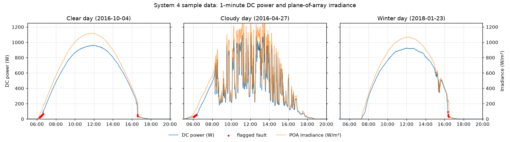

# PV Power Prediction and Anomaly Detection

Thesis: *Μοντέλα Πρόβλεψης Παραγόμενης Ισχύος και Ανίχνευσης Ανωμαλιών σε Φωτοβολταϊκά Συστήματα*
· Author: Dimitrios Stampoulidis · Data: [NREL PVDAQ](https://data.openei.org/submissions/4568) (CC-BY)

Predicts the DC power of PV system 4 from its sensors and from the weather, forecasts it 1 h and 3 h ahead, and
detects faults by comparing the measured power with the expected power. System 1283 is used only as a
generalization check; its results are in `artifacts/metrics/system_1283_*`. Folder map: `structure.MD`.

- **How it works:** [docs/PIPELINE.md](docs/PIPELINE.md) explains each step in words and figures.
- **What the data look like:** [data/sample/](data/sample/) has three days of system 4 (raw and cleaned) that
  you can open without downloading anything.



There are two ways to use this repository:

- **A. Run the app only** (5 minutes, no data download): the trained models are already in `app/bundle/`.
- **B. Reproduce the whole pipeline** (download about 20 GB, run notebooks 1-6, rebuild the app bundle).

## Requirements

- Python **3.12** (tested with 3.12.3) and `git`
- Linux, macOS or Windows (commands below are for Linux / macOS; Windows notes are given where they differ)
- Only for B: the [AWS CLI](https://aws.amazon.com/cli/) (no AWS account needed) and about 25 GB of free disk

Keep the pinned package versions: the models are saved with pickle and only load with **scikit-learn 1.9.0**.

## A. Run the app

```bash
git clone https://github.com/dimst2001/solarML-thesis.git
cd solarML-thesis

python3.12 -m venv .venv
source .venv/bin/activate            # Windows: .venv\Scripts\activate
pip install -r app/requirements.txt  # streamlit, scikit-learn 1.9.0, numpy, pandas

streamlit run app/app.py
```

Open <http://localhost:8501> (Streamlit usually opens it by itself) and keep the terminal open; stop it with
`Ctrl+C`. The page has three tabs:

| Tab | What it does |
|---|---|
| Predict power | expected DC power of system 4 from a date, time and air temperature (weather model), or from irradiance and module temperature (sensor model), plus the whole-day curve |
| Fault check | compares a measured power with the expected one and rates it green / yellow / orange / red |
| About the models | which model was chosen per task, its test RMSE / R² and the fault thresholds |

The app reads only `app/bundle/` (2 models, 2 scalers, `bundle.json`, about 150 KB), so the `app/` folder can be
copied to another computer on its own. To open it from another device on the same network:

```bash
streamlit run app/app.py --server.address 0.0.0.0
# then browse to http://<this computer's IP>:8501
```

**Troubleshooting**

- `ModuleNotFoundError` / `AttributeError` while loading a `.pkl`: the installed scikit-learn is not 1.9.0;
  reinstall with `pip install -r app/requirements.txt` in a clean environment.
- `Port 8501 is already in use`: add `--server.port 8502`.
- `streamlit: command not found`: the environment is not activated (`source .venv/bin/activate`).

## B. Reproduce the pipeline

### 1. Full environment

```bash
cd solarML-thesis
python3.12 -m venv .venv && source .venv/bin/activate
pip install -r configs/requirments.txt   # adds xgboost, matplotlib, seaborn, jupyterlab
python -m ipykernel install --user --name solar-thesis
```

### 2. Data

`data/` is not in Git. It is built from the public PVDAQ bucket (`s3://oedi-data-lake/pvdaq/`) with the download
scripts in the author's working folder `~/Desktop/solar-data-all/functions/` (these scripts are not part of this
repository; ask the author for them). They expect that exact folder layout:

```text
~/Desktop/solar-data-all/
├── functions/       # download and merge scripts
└── thesis/          # this repository
```

```bash
cd ~/Desktop/solar-data-all/functions
python download_list_then_cp.py   # aws s3 cp --no-sign-request, resumable, about 20 GB into ../pvdata/
python transform_data.py          # long -> wide format, one CSV per day, into ../pvdata_processed/
python merge_systems.py           # one CSV per system, into ../merged/
mkdir -p ../thesis/data && mv ../merged ../thesis/data/
```

Without the scripts, the same data can be downloaded by hand: system 4 is in
`s3://oedi-data-lake/pvdaq/parquet/pvdata/system_id=4/` (sensor names in
`pvdaq/parquet/metrics/metrics__system_4__part000.parquet`), e.g.
`aws s3 cp --no-sign-request --recursive s3://oedi-data-lake/pvdaq/parquet/pvdata/system_id=4/ pvdata/system_4/`.
The data come in long format (one row per sensor and timestamp); the notebooks need one wide CSV `data/merged/system_4_merged.csv` with a `datetime` column and one column per sensor
(`<sensor_name>__<metric_id>`, e.g. `dc_power__314`).

### 3. Notebooks

Start `jupyter lab` from the repository folder (or use VS Code), choose the `solar-thesis` kernel and run the
notebooks in `notebooks/` in this order, each from top to bottom:

| # | Notebook | Result |
|---|---|---|
| 1 | `1_Data_preproccesing` | cleaned data, fault flags, 15-minute grid (`data/cleaned/`) |
| 2 | `2_Feature_Selection` | feature sets, train/test split, forecasting datasets (`data/features/`, scalers) |
| 3 | `3A`, `3B` (estimation), `3C`, `3D` (forecast 1 h / 3 h) | 5 trained models per task (`artifacts/models/`) |
| 4 | `4_Evaluation_Comparison` | comparison and best model per task |
| 5 | `5_Anomaly_Detection` | rule vs model residual vs Isolation Forest, detector thresholds |
| 6 | `6_Results_Summary` | thesis tables, figures A-C and conclusions (systems 4 and 1283) |

`Demo_pipeline.ipynb` is a short stand-alone walkthrough and is not needed for the results. All charts and
tables are saved in `artifacts/metrics/` (`thesis_table_*` and `thesis_figure_*` are the final ones). The
system-1283 notebooks are kept outside the repository; its results are already in `artifacts/metrics/`.

### 4. Rebuild the app bundle

After re-running notebooks 3-5, copy the newly chosen models into the app and start it as in A:

```bash
python app/export_bundle.py   # rewrites app/bundle/ from artifacts/ and data/cleaned/
streamlit run app/app.py
```
