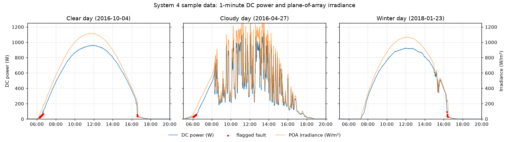

# System 4 data preview

Three days of NREL PVDAQ system 4, small enough to keep in Git (the full data are about 450 MB and are not
tracked). The days are the ones used as examples in notebook 4.

| Day | Weather |
|---|---|
| 2016-10-04 | clear |
| 2016-04-27 | broken clouds |
| 2018-01-23 | winter, clear with a late-afternoon shadow |



## Files

**`system_4_raw_preview.csv`**: 4,320 rows (1-minute readings, 24 h per day, nights included), exactly as in
`data/merged/system_4_merged.csv`, the input of notebook 1. Missing readings can appear as the codes `-99999` or
`-7999`.

| Column | Meaning | Unit |
|---|---|---|
| `system_id` | PVDAQ system number | |
| `datetime` | local timestamp | |
| `poa_irradiance__313` | plane-of-array irradiance | W/m² |
| `dc_power__314` | DC power of the array (**target**) | W |
| `ac_power__315` | AC power at the inverter output | W |
| `dc_pos_voltage__316`, `dc_pos_current__317` | DC voltage / current | V, A |
| `ac_voltage__318`, `ac_current__319` | AC voltage / current | V, A |
| `ambient_temp__320` | air temperature | °C |
| `module_temp_1__321` | back-of-module temperature | °C |
| `das_temp__325` | data-logger enclosure temperature | °C |

The number after `__` is the PVDAQ metric id.

**`system_4_cleaned_preview.csv`**: 1,881 rows, the same days after notebook 1 (as in
`data/cleaned/system_4_cleaned.csv`): daylight rows only (irradiance > 50 W/m²), the 5 columns that are kept, and
`is_fault`, which is True when the power is below half of what the irradiance predicts (51 rows here, all at
sunrise or sunset when the array is shaded).

## Quick look

```python
import pandas as pd
df = pd.read_csv("data/sample/system_4_raw_preview.csv", parse_dates=["datetime"])
df.set_index("datetime")[["dc_power__314", "poa_irradiance__313"]].plot()
```
