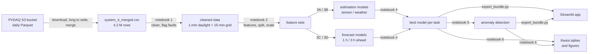
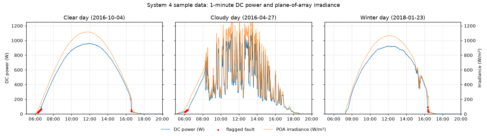
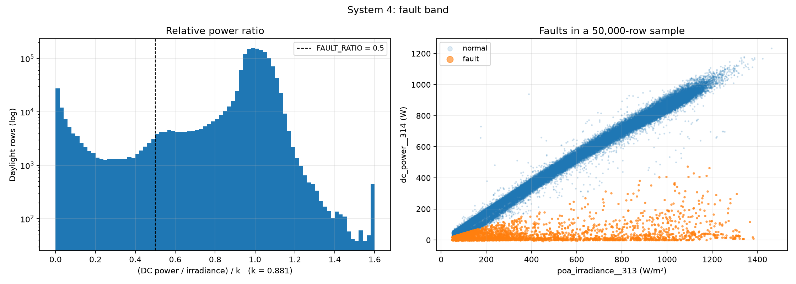
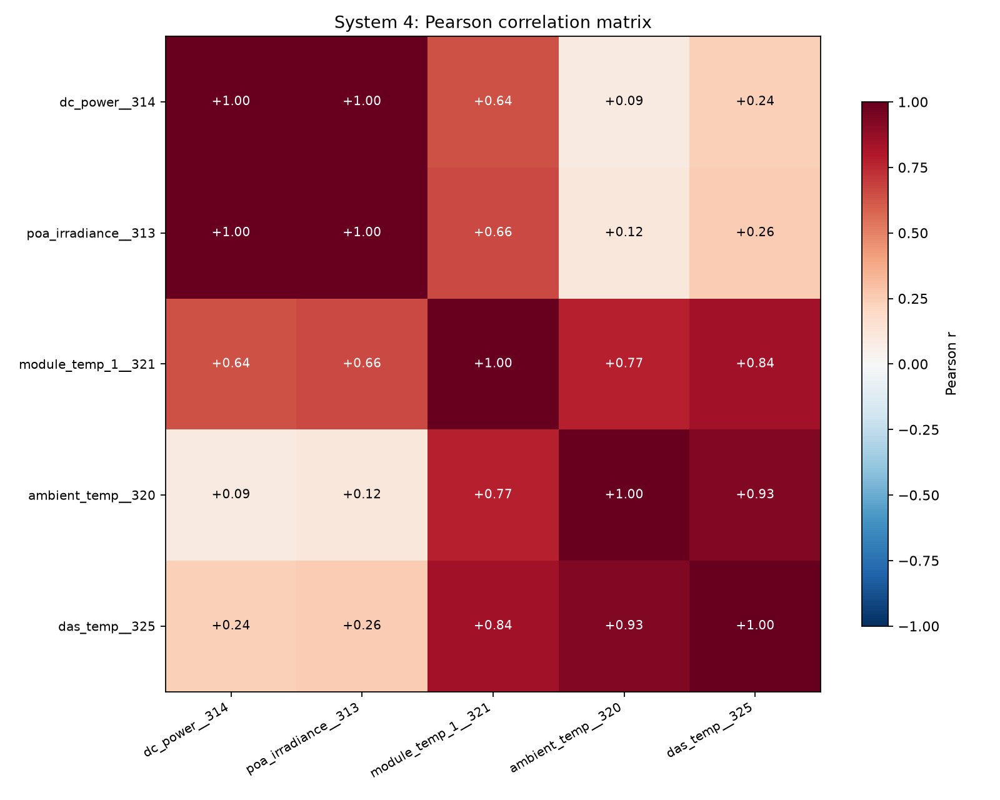
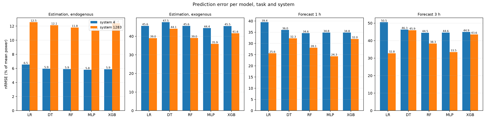
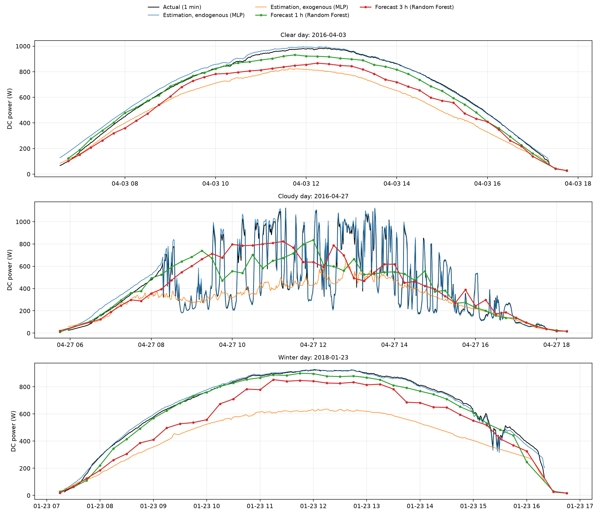
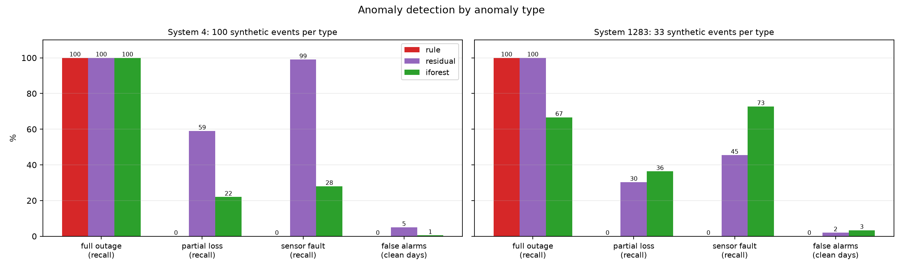
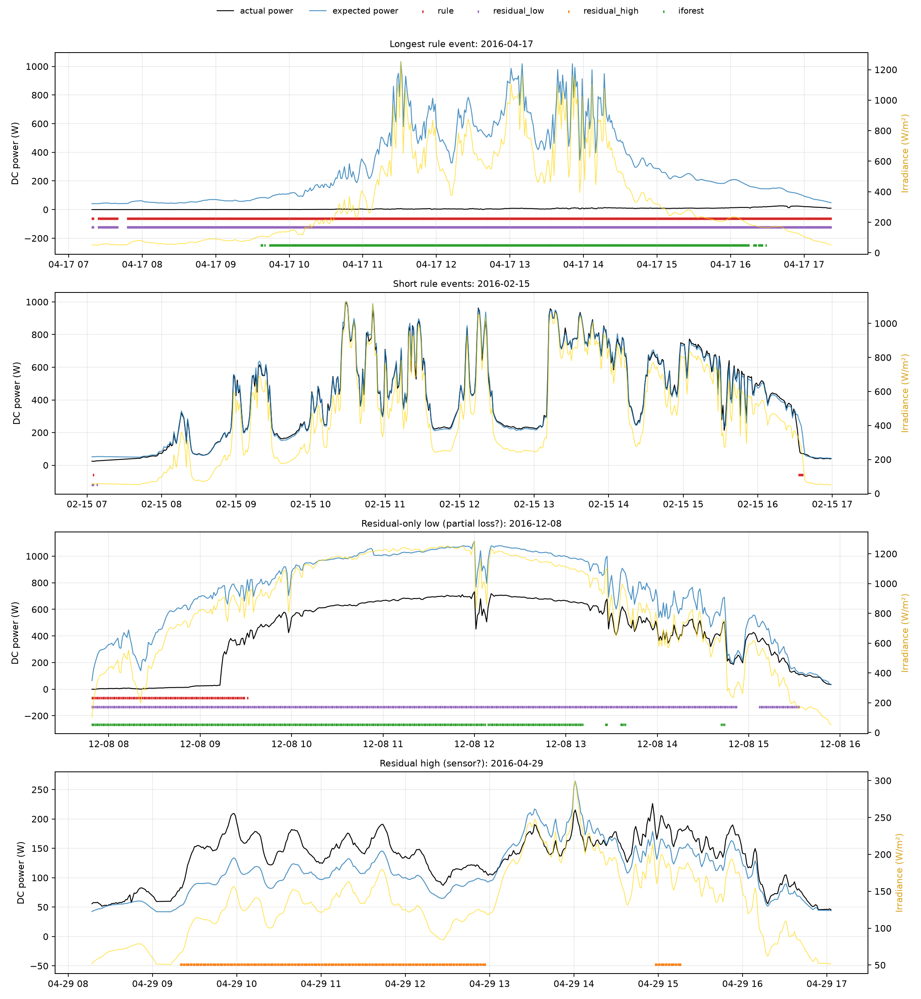

# How the pipeline works

This page explains what each step does and why, using the figures the notebooks save. Commands for running the
steps are in the [README](../README.md); every number below is from system 4.

## 0. The data

System 4 is a small PV array (about 1 kW peak) from the NREL PVDAQ public dataset with readings from August
2007 to January 2023: every 15 minutes until mid-2009, every minute from 2010. Each reading has the DC power
(what we predict), the irradiance on the panel plane, three temperatures and the electrical values. A 3-day
sample is in [`data/sample/`](../data/sample/).

On a clear day the power follows the irradiance almost exactly. On a cloudy day both jump up and down within
minutes. That close match is why the irradiance is the most important input.

## 1. Cleaning and fault flags (notebook 1)

- **Missing values.** The logger codes `-99999` and `-7999` are set to empty, and rows that still have a gap are
  dropped. Nothing is filled in.
- **Daylight only.** Rows with irradiance > 50 W/m² are kept. The filter uses the irradiance, not the power, so
  real daylight outages (sun but no power) stay in the data.
- **Fault flag.** On a normal day the power is about *k* × irradiance, with *k* = 0.881 W per W/m², measured on the
  training period only (first 80% of the rows in time order, the split of notebook 2), so the labels never see the
  test period. A row is flagged as a fault when the power is less than half of that. Faults are marked, not deleted:
  6.5% of daylight rows, in 2,665 events.

*Left:* the ratio of the measured to the expected power has two peaks: normal operation near 1 and outages near 0.
The threshold of 0.5 sits in the valley between them. *Right:* the flagged rows (orange) lie far below the normal
line.

Outputs: the 1-minute daylight data (1.4 M rows) for the estimation models, and a regular 15-minute grid with
nights included for forecasting.

## 2. Features and split (notebook 2)

Only normal rows are used for training, because the models must learn what *healthy* production looks like.

| Feature set | Inputs | Question it answers |
|---|---|---|
| **Endogenous** (sensor) | irradiance, module temperature | What should the panel produce right now, given what its sensors measure? |
| **Exogenous** (weather) | air temperature, time of day, day of year (as sin / cos) | What can we expect from the weather and the calendar alone, without an irradiance sensor? |
| **Forecast 1 h / 3 h** | power and irradiance now, 1 h and 24 h ago, temperature, the target's time | What will the power be in 1 or 3 hours? |

Voltage and current are left out: power = voltage × current, so using them would give away the answer.

Irradiance correlates with the power at r = 0.995 and module temperature at 0.64. Air temperature and logger
temperature correlate with each other (r = 0.93), so only one of them is used.

The split is by **time**: the first 80% (2007–Jan 2016) for training, the rest for testing. A random split would
put neighbouring minutes, which are almost identical, in both sets and make the scores look 9–13% better than they
really are. The inputs are scaled to 0–1 with a scaler fitted on the training data only.

## 3. Training (notebooks 3A–3D)

The same five models are trained for each of the four tasks: **Linear Regression, Decision Tree, Random Forest,
MLP (neural network) and XGBoost**. Each is checked with 5-fold time-series cross-validation (always training on
the past and testing on the future), then trained on the full training set and scored on the test set.
Forecasts are also compared with two simple baselines: *persistence* (power stays as it is now) and
*same time yesterday*.

Error as a % of the mean power (lower is better; blue = system 4). The inputs matter much more than the choice of
model:

| Task | Best model | RMSE | R² |
|---|---|---|---|
| Estimation, sensor | MLP | 28 W (5.8%) | 0.99 |
| Estimation, weather | MLP | 217 W (44%) | 0.48 |
| Forecast 1 h | Random Forest | 140 W (35%) | 0.81 |
| Forecast 3 h | XGBoost (tied with Random Forest and MLP, fastest) | 182 W (45%) | 0.68 |

Without the irradiance sensor the error is about 8 times higher: the calendar knows the sun's position but not
the clouds. The forecasts beat persistence by 34% (1 h) and 54% (3 h).

## 4. Evaluation (notebook 4)

All models are compared on the same test days. A bootstrap over test days decides which differences are real; among
the models tied with the best, the fastest to train is chosen. The figure shows the chosen models on three test days:

The sensor model (blue) follows every cloud. The weather model (orange) predicts an "average" day and so
underestimates clear days. The 1 h forecast (green) follows the trend, and the 3 h forecast (red) lags behind.

## 5. Anomaly detection (notebook 5)

The sensor MLP is used as a reference for healthy behaviour: **residual = (measured − expected) / expected**.
Three detectors are compared:

- **Rule**: the fault flag from step 1 (power < 50% of *k* × irradiance).
- **Residual**: flags a reading when the residual (15-minute median) is more than 5 robust standard deviations from
  normal, i.e. about −21% / +23%.
- **Isolation Forest**: an unsupervised outlier detector on power, irradiance, temperature and residual.

The data have no labels for partial losses, so synthetic 2-hour events are injected on clean test days: full
outage (power = 0), partial loss (power × 0.6–0.9) and sensor fault (irradiance × 0.6–0.8).

All three detectors catch full outages, but only the residual detector also finds partial losses (59%) and sensor
faults (99%), with 5% false alarms. Losses smaller than about 20% are hidden in the model's normal error.

Real test days, measured power (black) vs expected (blue):

1. A full-day outage that every detector flags.
2. Short rule events at sunrise and sunset.
3. Power capped at about 700 W instead of 1,050 W (probably snow): the rule only flags the morning, while the
   residual flags the whole day.
4. Power above the expected value on a dull day, which suggests the irradiance sensor reads too low.

## 6. Results and app

Notebook 6 collects the final tables and figures (`artifacts/metrics/thesis_*`) for system 4 and system 1283, a
much larger system used to check that the conclusions still hold.

`app/export_bundle.py` copies the two estimation models and the detector thresholds into `app/bundle/`. The
Streamlit app uses them to predict the power for any date and weather, and to rate a measured power as
green (< 3σ), yellow (3–5σ), orange (5–8σ) or red (> 8σ).
